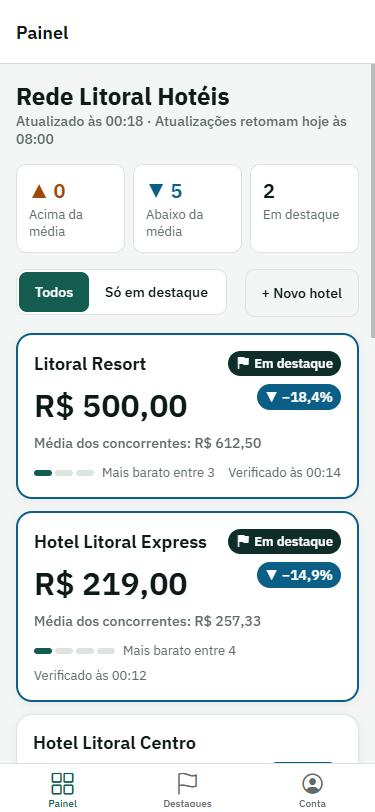
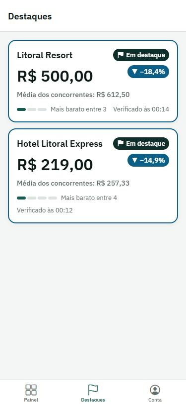
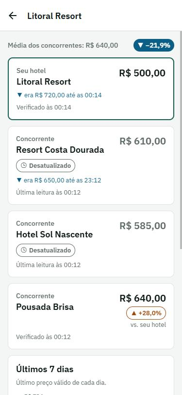
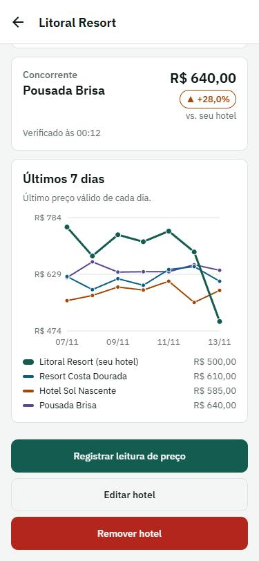
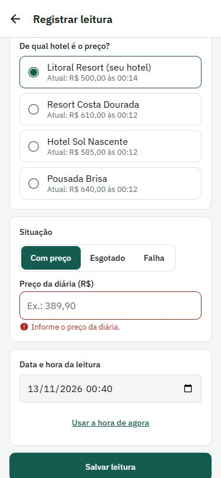
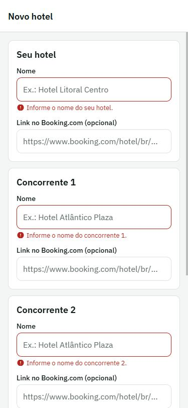

# HOFIX

Aplicativo (Android, iPhone e web) em que uma rede hoteleira acompanha o preço da diária de hoje dos seus hotéis comparado com o dos concorrentes diretos.

Projeto Final da disciplina de Programação para Dispositivos Móveis (IESB). Stack: **React Native (Expo) + Firebase**.

## O que o app faz

- **Painel:** um cartão por hotel, com o preço de hoje, a média dos 3 concorrentes, a diferença em % e a posição entre os 4 preços. Hotéis com diferença acima do limite (10%) aparecem **em destaque** no topo.
- **Detalhe do hotel:** o hotel comparado linha a linha com cada concorrente, o preço anterior quando mudou e um **gráfico dos últimos 7 dias**.
- **Registrar leitura de preço:** formulário para informar o preço de um hotel ou concorrente (com preço, esgotado ou falha), com data e hora escolhidas no seletor nativo do aparelho.
- **Cadastro, edição e remoção de hotéis**, cada um com 3 concorrentes.
- **Login** com e-mail e senha. Tudo é atualizado em tempo real: quem estiver com o app aberto vê uma leitura nova na hora.

### Escopo desta entrega

Esta é a versão acadêmica do HOFIX. Os preços entram **manualmente**, pelo formulário "Registrar leitura de preço", e por uma **carga de dados de exemplo** (Rede Litoral Hotéis: 9 hotéis com 3 concorrentes cada).

A coleta automática de preços no Booking.com **não faz parte desta entrega**. Ela pertence à visão de produto comercial, descrita nos documentos de `docs/produto/`, que ficam no repositório só como referência.

## Telas

| Painel | Destaques | Detalhe do hotel |
|---|---|---|
|  |  |  |

| Gráfico de 7 dias | Registrar leitura | Validação do formulário |
|---|---|---|
|  |  |  |

## Como instalar e rodar

Pré-requisitos: [Node.js LTS](https://nodejs.org) e [Git](https://git-scm.com). Para testar no celular, o app **Expo Go**.

```bash
git clone https://github.com/hagaele/hotel-scanner.git
cd hotel-scanner/app
npm install
```

Crie o arquivo `app/.env` com as chaves do Firebase (veja a próxima seção) e rode:

```bash
npx expo start -c
```

- **Celular:** leia o QR code com o Expo Go (o celular e o computador precisam estar no mesmo Wi-Fi).
- **Navegador:** pressione `w` no terminal.

Os recursos nativos (vibração e seletor de data e hora do sistema) só aparecem no celular. No navegador o campo de data usa o seletor do próprio navegador e a vibração é ignorada.

## Configurar o Firebase de teste

O app precisa de um projeto Firebase com **Authentication** e **Firestore**. As chaves ficam em `app/.env`, que não vai para o Git.

**Para a avaliação:** o arquivo `.env` do projeto de teste da equipe e um usuário de teste (e-mail e senha) são enviados junto com a entrega, fora do repositório. Basta copiar o `.env` para a pasta `app/` e rodar.

**Para usar um projeto Firebase próprio:**

1. No [Console do Firebase](https://console.firebase.google.com), crie um projeto.
2. **Authentication → Começar → Método de login → E-mail/senha → Ativar**.
3. **Authentication → Usuários → Adicionar usuário**: crie um usuário de teste.
4. **Firestore Database → Criar banco de dados**: modo de produção, região `southamerica-east1` (São Paulo).
5. Na aba **Regras** do Firestore, cole o conteúdo de [`firestore.rules`](firestore.rules) e clique em **Publicar**.
6. **Configurações do projeto → Seus apps → Web (`</>`)**: registre um app e copie os valores do `firebaseConfig`.
7. Copie `app/.env.example` para `app/.env` e preencha cada variável:

   ```
   EXPO_PUBLIC_FIREBASE_API_KEY=
   EXPO_PUBLIC_FIREBASE_AUTH_DOMAIN=
   EXPO_PUBLIC_FIREBASE_PROJECT_ID=
   EXPO_PUBLIC_FIREBASE_STORAGE_BUCKET=
   EXPO_PUBLIC_FIREBASE_MESSAGING_SENDER_ID=
   EXPO_PUBLIC_FIREBASE_APP_ID=
   ```

8. Rode `npx expo start -c`, entre com o usuário de teste e, na aba **Conta → Administração**, toque em **Carregar dados de exemplo**. Os 9 hotéis aparecem no Painel na hora.

## Requisitos do enunciado e onde estão no código

| Requisito | Onde está |
|---|---|
| Componentização | `app/src/components/`: `HotelCard`, `PriceRow`, `DiffChip`, `StatusBadge`, `Button`, `TextField`, `Banner`, `HotelForm`, `DateTimeField`, `PriceHistoryChart` e outros |
| Layout com Flexbox | Todas as telas. O Painel muda de 1 para 2 e 3 colunas conforme a largura (`HotelList`) |
| Feedback de carregando, erro e sucesso | `StateView`, `Banner` e o estado `loading` do `Button`, em todas as operações |
| Navegação com múltiplos navegadores | Expo Router: **Stack** na raiz (`src/app/_layout.tsx`) com **abas** dentro (`src/app/(tabs)/`) e um Stack de autenticação (`src/app/(auth)/`) |
| `useState` e `useReducer` | `useState` nas telas; `useReducer` no formulário de hotel (`src/lib/hotelForm.ts` e `HotelForm`) |
| Estado global (Context API) | `src/context/AuthContext.tsx`: usuário logado, entrar, sair e recuperar senha |
| Formulários com validação | Login (`src/lib/validation.ts`), hotel (`src/lib/hotelForm.ts`) e leitura de preço (`src/lib/readings.ts`) |
| Recurso nativo | **Haptics** (`src/lib/haptics.ts`): vibração ao salvar, ao errar e ao abrir um hotel em destaque. **DateTimePicker** (`src/components/DateTimeField.tsx`): data e hora da leitura |
| Ícones vetoriais | `@expo/vector-icons` (Ionicons) nas abas, selos, avisos e botões |
| Firestore: ler, gravar, editar e remover | `src/data/useHotels.ts` e `useHotelHistory.ts` (leitura em tempo real) e `src/data/hotelsRepository.ts` (criar, editar, remover e registrar leitura) |
| Firebase Auth | Login por e-mail e senha, sessão salva e rotas protegidas com `Stack.Protected` |

## Como funciona por dentro

### Autenticação

- `src/lib/firebase.ts` inicializa o Firebase com os valores do `.env`.
- `src/lib/auth.ts` (web) e `src/lib/auth.native.ts` (Android e iPhone) criam o Auth. No celular a sessão fica salva com AsyncStorage.
- `src/context/AuthContext.tsx` guarda o usuário logado num estado global (`useAuth()`).
- `src/app/_layout.tsx` protege as rotas: sem login só existem `login` e `esqueci-senha`.

### Modelo de dados (Firestore)

```
clients/{clientId}                                nome do cliente e limite de destaque (%)
clients/{clientId}/hotels/{hotelId}               ordem, hotel próprio e 3 concorrentes, cada um com o "latest"
clients/{clientId}/hotels/{hotelId}/checks/{id}   histórico: uma leitura por documento, nunca sobrescrita
```

- O Painel lê só os documentos de `hotels`, em tempo real (`onSnapshot`).
- Cada leitura cria um documento em `checks` e atualiza o `latest` da propriedade na mesma transação. `previousPrice` e `changedAt` só mudam quando o preço muda.
- O histórico (`checks`) só é lido no detalhe do hotel, com filtro dos últimos 7 dias e limite de documentos.
- As regras só deixam usuários autenticados lerem e escreverem. Leituras do histórico não podem ser alteradas nem apagadas.

### Recursos nativos

- **Haptics (`expo-haptics`):** vibração de sucesso ao salvar uma leitura ou um hotel, de erro quando a validação falha ou o servidor não responde, e de aviso ao abrir um hotel em destaque.
- **DateTimePicker (`@react-native-community/datetimepicker`):** no Android abre os diálogos de data e de hora do sistema; no iPhone mostra o seletor compacto do iOS. A leitura não pode ser no futuro nem ter mais de 7 dias.

### Gráfico de 7 dias

Desenhado com `react-native-svg`, que funciona em Android, iPhone e web. Mostra o último preço válido de cada dia: o hotel próprio em linha grossa e os concorrentes em linhas finas. As regras de montagem das séries ficam em `src/lib/history.ts`.

## Estrutura do repositório

```
app/                    Projeto Expo
  src/app/              Rotas (Expo Router): Stack na raiz, abas em (tabs)/, login em (auth)/
  src/components/       Componentes reutilizáveis
  src/context/          Estado global (AuthContext)
  src/data/             Firestore: leitura em tempo real, escritas e carga de exemplo
  src/lib/              Regras de preço, formatação, validação, Firebase e recursos nativos
  src/theme/            Cores, espaçamentos e tipografia
docs/
  CRONOGRAMA.md         Cronograma e regras do grupo
  ROTEIRO-VIDEO.md      Roteiro do vídeo de demonstração
  screenshots/          Capturas de tela usadas neste README
  design/               Briefing de identidade visual
  produto/              Documentos da visão de produto comercial (fora do escopo desta entrega)
firestore.rules         Regras de segurança do Firestore
```

## Git Flow

- `main`: versão entregue.
- `develop`: integração.
- `feature/*`: uma branch por etapa, mesclada na `develop` por Pull Request revisado por outro integrante.

## Equipe e divisão de tarefas

| Integrante | Branch | O que fez |
|---|---|---|
| Freud | `feature/setup-navegacao` | Projeto Expo com TypeScript, navegação (Stack e abas), tema HOFIX, componentes base, Painel e detalhe com dados de exemplo |
| Sofia | `feature/firebase-auth` | Configuração do Firebase, login por e-mail e senha, `AuthContext`, formulário validado, proteção de rotas e botão Sair |
| Hugo | `feature/hoteis-firestore` | Firestore em tempo real, cadastro, edição e remoção de hotéis (`useReducer`), registro de leitura de preço, carga inicial e regras de segurança |
| Matheus | `feature/nativos-readme` | Recursos nativos (Haptics e DateTimePicker), gráfico de 7 dias, README final e roteiro do vídeo |

O cronograma e os revisores de cada Pull Request estão em [docs/CRONOGRAMA.md](docs/CRONOGRAMA.md).
