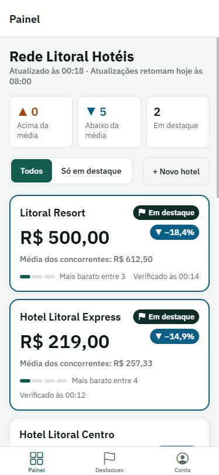
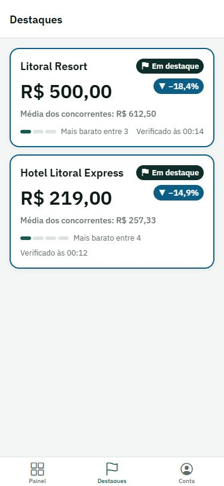
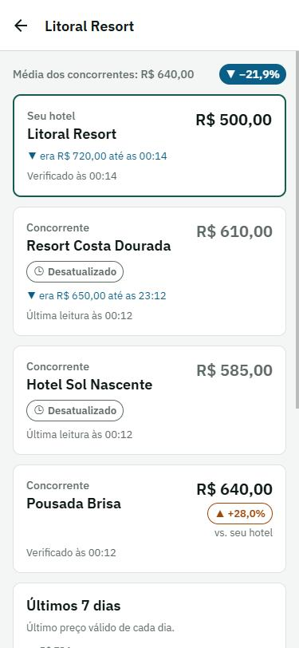
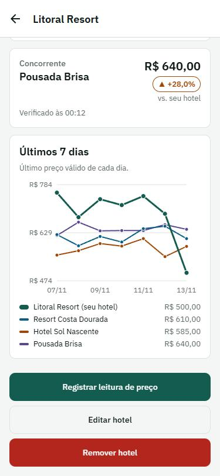
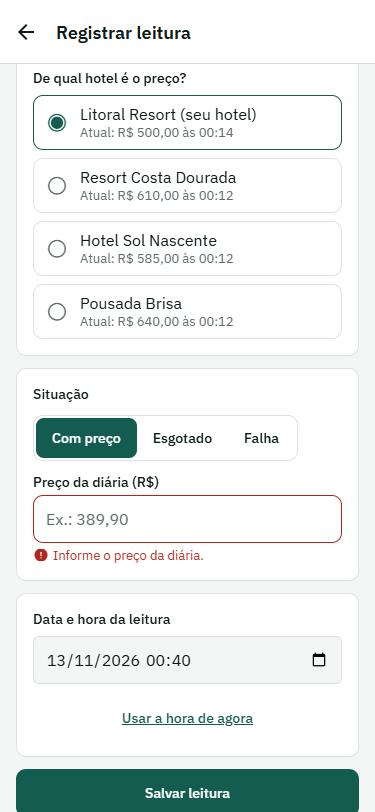
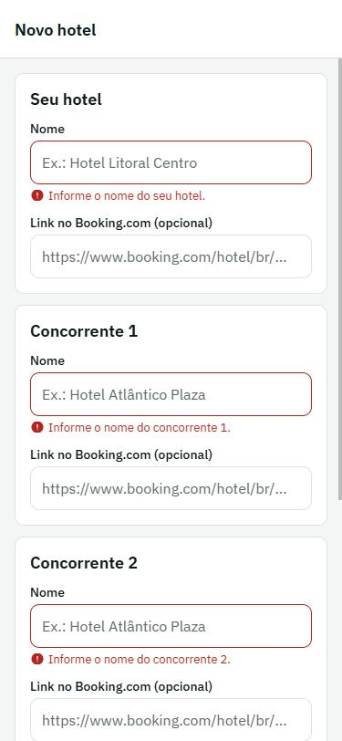

# HOFIX

Aplicativo (Android, iPhone e web) em que uma rede hoteleira acompanha o preço da diária de hoje dos seus hotéis comparado com o dos concorrentes diretos.

Projeto Final da disciplina de Programação para Dispositivos Móveis (IESB). Stack: **React Native (Expo) + Firebase**.

## O que o app faz

- **Visão geral:** indicadores da rede (diária média, média do mercado, posição da rede, unidades acima e abaixo da média), o próximo feriado ou evento com o efeito no mercado, filtro por localização e um cartão por unidade com o preço de hoje, a diferença para os concorrentes e a **sugestão de preço de hoje**.
- **Comparativo por data:** para cada unidade, os preços dos concorrentes noite a noite (7, 14 ou 30 dias), a faixa do mercado (mínimo, mediana e máximo) num gráfico, a **sugestão de preço explicada** e o registro da decisão.
- **Calendário de sazonalidade:** o mês colorido pelo nível de preço do mercado em cada localização, feriados nacionais calculados, eventos e feriados locais cadastrados pelo usuário e **datas suspeitas de evento** detectadas pelos preços.
- **Catálogo:** pesquisa por nome, localização, faixa de preço e tipo (unidade ou concorrente), comparação com uma unidade de referência e **pesquisas salvas**.
- **Central de notificações (Alertas):** alertas calculados a partir dos preços, agrupados por unidade, com marcação de lidos por usuário, filtros e **regras de alerta configuráveis**. O número de não lidos aparece no ícone da aba.
- **Detalhe do hotel:** o hotel comparado linha a linha com cada concorrente, o preço anterior quando mudou e um **gráfico dos últimos 7 dias**.
- **Registrar leitura de preço:** preço de um hotel ou concorrente para **uma noite** (hoje ou até 60 dias à frente), com preço, esgotado ou falha. A noite de hoje atualiza o painel; noites futuras alimentam o comparativo, o calendário e os alertas.
- **Cadastro um por um:** o usuário escolhe se é um **hotel da rede** (com localização e preço-piso; a localização é escolhida em dois passos, primeiro a UF e depois a cidade, na lista de municípios da UF vinda da API pública de localidades do IBGE) ou um **concorrente**. O concorrente é vinculado a um ou mais hotéis da rede (até 5 concorrentes por hotel), e a mesma leitura de preço vale para todos os vínculos. Na tela do hotel, cada item tem **Editar** e **Remover** (remover um concorrente desfaz só aquele vínculo).
- **Login** com e-mail e senha. Tudo é atualizado em tempo real: quem estiver com o app aberto vê uma leitura nova na hora.

### Escopo desta entrega

Esta é a versão acadêmica do HOFIX. Os preços entram **manualmente**, pelo formulário "Registrar leitura de preço", e por uma **carga de dados de exemplo** (Rede Cerrado Hotéis: 9 hotéis com 3 concorrentes cada, em Brasília/DF, Goiânia/GO e Caldas Novas/GO, com tarifas para as próximas 30 noites, um evento cadastrado e uma data com alta de preços sem feriado).

Também ficam fora desta entrega: fotos e notas de avaliação de sites de reserva, alertas por e-mail ou WhatsApp e alteração automática de preços nos canais de venda. O app sugere e registra a decisão; o preço é aplicado pela equipe no canal de venda.

A coleta automática de preços no Booking.com **não faz parte desta entrega**. Ela pertence à visão de produto comercial, descrita nos documentos de `docs/produto/`, que ficam no repositório só como referência.

## Telas

> As capturas abaixo são da versão 1.0 (painel, detalhe e formulários). As telas de Visão geral, Comparativo, Calendário, Catálogo e Alertas entram nas capturas da versão final.

| Painel | Destaques | Detalhe do hotel |
|---|---|---|
|  |  |  |

| Gráfico de 7 dias | Registrar leitura | Validação do formulário |
|---|---|---|
|  |  |  |

## Como instalar e rodar

Pré-requisitos: [Node.js LTS](https://nodejs.org) e [Git](https://git-scm.com). Para testar no celular, o app **Expo Go**.

```bash
git clone https://github.com/hagaele/hotel-scanner.git
cd hotel-scanner/app
npm install
```

Crie o arquivo `app/.env` com as chaves do Firebase (veja a próxima seção) e rode:

```bash
npx expo start -c
```

- **Celular:** leia o QR code com o Expo Go (o celular e o computador precisam estar no mesmo Wi-Fi).
- **Navegador:** pressione `w` no terminal.

Os recursos nativos (vibração e seletor de data e hora do sistema) só aparecem no celular. No navegador o campo de data usa o seletor do próprio navegador e a vibração é ignorada.

## Configurar o Firebase de teste

O app precisa de um projeto Firebase com **Authentication** e **Firestore**. As chaves ficam em `app/.env`, que não vai para o Git.

**Para a avaliação:** o arquivo `.env` do projeto de teste da equipe e um usuário de teste (e-mail e senha) são enviados junto com a entrega, fora do repositório. Basta copiar o `.env` para a pasta `app/` e rodar.

**Para usar um projeto Firebase próprio:**

1. No [Console do Firebase](https://console.firebase.google.com), crie um projeto.
2. **Authentication → Começar → Método de login → E-mail/senha → Ativar**.
3. **Authentication → Usuários → Adicionar usuário**: crie um usuário de teste.
4. **Firestore Database → Criar banco de dados**: modo de produção, região `southamerica-east1` (São Paulo).
5. Na aba **Regras** do Firestore, cole o conteúdo de [`firestore.rules`](firestore.rules) e clique em **Publicar**.
6. **Configurações do projeto → Seus apps → Web (`</>`)**: registre um app e copie os valores do `firebaseConfig`.
7. Copie `app/.env.example` para `app/.env` e preencha cada variável:

   ```
   EXPO_PUBLIC_FIREBASE_API_KEY=
   EXPO_PUBLIC_FIREBASE_AUTH_DOMAIN=
   EXPO_PUBLIC_FIREBASE_PROJECT_ID=
   EXPO_PUBLIC_FIREBASE_STORAGE_BUCKET=
   EXPO_PUBLIC_FIREBASE_MESSAGING_SENDER_ID=
   EXPO_PUBLIC_FIREBASE_APP_ID=
   ```

8. Rode `npx expo start -c`, entre com o usuário de teste e, na aba **Conta → Administração**, toque em **Carregar dados de exemplo**. Os 9 hotéis aparecem no Painel na hora.

## Requisitos do enunciado e onde estão no código

| Requisito | Onde está |
|---|---|
| Componentização | `app/src/components/`: `HotelCard`, `PriceRow`, `DiffChip`, `StatusBadge`, `Button`, `TextField`, `Banner`, `Card`, `Chips`, `KpiTile`, `DateTypeTag`, `SwitchRow`, `RangeChart`, `CalendarMonth`, `AlertCard`, `HotelForm`, `DateTimeField`, `PriceHistoryChart` e outros |
| Layout com Flexbox | Todas as telas. A lista de unidades muda de 1 para 2 e 3 colunas conforme a largura (`HotelList`); o calendário é uma grade de 7 colunas feita com `flexWrap` (`CalendarMonth`); o gráfico de faixa é feito só com `View` (`RangeChart`) |
| Feedback de carregando, erro e sucesso | `StateView`, `Banner` e o estado `loading` do `Button`, em todas as operações |
| Navegação com múltiplos navegadores | Expo Router com três níveis integrados: **Stack** na raiz (`src/app/_layout.tsx`, com `Stack.Protected`) → **Tabs** (`src/app/(tabs)/_layout.tsx`: Visão geral, Calendário, Catálogo, Alertas e Conta) → um **Stack por aba** (`src/components/TabStack.tsx`), onde entram as telas de detalhe compartilhadas. Mais um Stack de autenticação (`src/app/(auth)/`). Detalhes em [Navegação](#navegação) |
| `useState` e `useReducer` | `useState` nas telas; `useReducer` no formulário de cadastro (`src/lib/hotelForm.ts` e `HotelForm`) |
| Estado global (Context API) | `src/context/AuthContext.tsx` (usuário logado), `src/context/ThemeContext.tsx` (tema claro, escuro ou do aparelho, salvo no aparelho) e `src/context/HotelsContext.tsx` (hotéis, tarifas, eventos, pesquisas salvas e alertas, em tempo real, compartilhados por todas as telas; o número de alertas não lidos aparece na aba) |
| Formulários com validação | Login (`src/lib/validation.ts`), cadastro de hotel da rede ou concorrente, com vínculos e limite de 5 (`src/lib/hotelForm.ts`), leitura de preço com noite da estadia (`src/lib/readings.ts`), evento do calendário (`src/lib/calendarForm.ts`), filtros e pesquisa salva (`src/lib/catalog.ts`) |
| Recurso nativo | **Haptics** (`src/lib/haptics.ts`): vibração ao salvar, ao errar e ao abrir um hotel em destaque. **DateTimePicker** (`src/components/DateTimeField.tsx`): noite da estadia e data e hora da leitura. **Switch** nativo nas regras de alerta |
| Ícones vetoriais | `@expo/vector-icons` (Ionicons) nas abas, selos, avisos, calendário e botões |
| Firestore: ler, gravar, editar e remover | Leitura em tempo real em `src/context/HotelsContext.tsx`; hotéis e leituras em `src/data/hotelsRepository.ts`; eventos em `calendarRepository.ts`; pesquisas em `catalogRepository.ts`; decisões em `decisions.ts`; alertas lidos e regras em `alertsRepository.ts` |
| Firebase Auth | Login por e-mail e senha, sessão salva e rotas protegidas com `Stack.Protected` |

## Como funciona por dentro

### Autenticação

- `src/lib/firebase.ts` inicializa o Firebase com os valores do `.env`.
- `src/lib/auth.ts` (web) e `src/lib/auth.native.ts` (Android e iPhone) criam o Auth. No celular a sessão fica salva com AsyncStorage.
- `src/context/AuthContext.tsx` guarda o usuário logado num estado global (`useAuth()`).
- `src/app/_layout.tsx` protege as rotas: sem login só existem `login` e `esqueci-senha`.

### Navegação

Três navegadores aninhados, todos do Expo Router (rotas por arquivo em `app/src/app/`):

```
Stack raiz                      src/app/_layout.tsx
├── (auth)  Stack               login, esqueci-senha              ← só sem login
└── (tabs)  Tabs                src/app/(tabs)/_layout.tsx        ← só com login
    ├── (1-painel)      Stack   index            → /
    ├── (2-calendario)  Stack   calendario       → /calendario
    ├── (3-catalogo)    Stack   catalogo         → /catalogo
    ├── (4-alertas)     Stack   alertas          → /alertas
    ├── conta                                    → /conta
    └── (1-painel,2-calendario,3-catalogo,4-alertas)    telas compartilhadas pelas 4 pilhas
        ├── hotel/[id]          detalhe do hotel  → /hotel/:id
        ├── hotel/novo          novo cadastro     → /hotel/novo
        ├── hotel/editar/[id]   edição            → /hotel/editar/:id
        ├── comparativo/[id]    comparativo       → /comparativo/:id
        └── leitura/[id]        registrar leitura → /leitura/:id
```

- **Stack raiz com rotas protegidas.** `Stack.Protected` mostra o grupo `(auth)` para quem não entrou e o grupo `(tabs)` para quem entrou. Ao entrar ou sair, o navegador troca de grupo sozinho, sem `if` nas telas.
- **Abas.** No celular aparecem na barra inferior. Em telas largas viram links na barra superior (`AppHeader`). O número de alertas não lidos aparece na aba Alertas.
- **Uma pilha por aba.** Cada grupo de aba tem um `_layout.tsx` com o `TabStack` (Native Stack). As telas de detalhe abrem por cima da aba, com animação e, no iPhone, gesto de arrastar para voltar. O menu continua visível.
- **Telas compartilhadas (*shared routes*).** A pasta com o nome dos quatro grupos separados por vírgula gera as mesmas telas dentro de cada pilha, sem duplicar código. O Expo Router abre a tela na pilha da aba em que o usuário está. Um comparativo aberto pelo Calendário fica na pilha do Calendário, com a aba marcada, e "Voltar" retorna ao Calendário.
- **Cada aba guarda a própria pilha.** Se o usuário troca de aba e volta, a tela de detalhe continua aberta. Tocar de novo na aba ativa volta ao início dela.
- **Âncoras.** Cada pilha define a tela-base em `unstable_settings.anchor`. Um endereço de detalhe aberto direto (recarga da página, link compartilhado) já tem a base da aba embaixo, e "Voltar" funciona.
- **Por que os números nos nomes dos grupos.** Um endereço aberto direto cai no primeiro grupo em ordem alfabética. Os números (que não aparecem na URL) seguem a ordem das abas e fazem esse primeiro grupo ser a Visão geral.
- **Botão "Voltar".** Fica na barra superior (`AppHeader`) nas telas de detalhe e desempilha a tela atual. Na web, os botões voltar e avançar do navegador seguem a mesma pilha.

### Modelo de dados (Firestore)

```
clients/{clientId}                                  nome do cliente, limite de destaque (%) e regras de alerta
clients/{clientId}/hotels/{hotelId}                 ordem, localização, preço-piso, hotel próprio e até 5 concorrentes, cada um com o "latest"; o mesmo concorrente em vários hotéis tem o mesmo competitorKey
clients/{clientId}/hotels/{hotelId}/checks/{id}     histórico: uma leitura por documento, com a noite da estadia (stayDate), nunca sobrescrita
clients/{clientId}/hotels/{hotelId}/decisions/{id}  decisões sobre a sugestão de preço de uma noite
clients/{clientId}/events/{id}                      eventos e feriados locais (e datas marcadas como "não é evento")
clients/{clientId}/savedSearches/{id}               pesquisas salvas do catálogo
clients/{clientId}/userState/{uid}                  alertas já lidos por cada usuário
```

- O estado global (`HotelsContext`) mantém uma única leitura em tempo real (`onSnapshot`) de cada coleção, compartilhada por todas as telas, e cancela os ouvintes ao sair.
- Cada leitura cria um documento em `checks`. Se a noite for hoje, também atualiza o `latest` da propriedade na mesma transação; `previousPrice` e `changedAt` só mudam quando o preço muda.
- As tarifas por data (`checks` com `stayDate`) são lidas só na janela usada pelas telas: do início do mês atual até 60 dias à frente.
- As regras (`firestore.rules`) só deixam usuários autenticados lerem e escreverem. Leituras e decisões não podem ser alteradas nem apagadas; cada usuário só lê e grava os próprios alertas lidos. Elas também conferem o formato do que é gravado (nomes com tamanho máximo, preços entre R$ 0 e R$ 100.000, datas no formato AAAA-MM-DD, até 5 concorrentes por hotel, links só https), para um dado gravado fora do app não quebrar as telas.
- O login por e-mail e senha do Firebase permite criar contas pela API mesmo sem tela de cadastro no app. Para só a equipe acessar, desligue a criação de contas em **Authentication > Settings > User actions > Enable create (sign-up)**.
- No app, os links do Booking são conferidos de novo antes de abrir (só https), e uma tela de erro em português substitui a tela em branco se algo quebrar. **Ao atualizar o projeto, publique de novo o `firestore.rules` no console do Firebase.**

### Sugestão de preço

Regras puras em `src/lib/market.ts`, sem Firebase:

- A faixa sugerida acompanha a **mediana dos concorrentes** da noite (de -3% a +2%). Com concorrentes esgotados, a faixa sobe um pouco (sinal de demanda). Nunca fica abaixo do **preço-piso** da unidade.
- A regra não é "ficar abaixo do concorrente": isso levaria a uma corrida de preço e à perda de margem.
- Cada sugestão vem com a explicação (mediana, sua diária, esgotados, tipo de data, preço-piso).
- Tipo de data: feriados nacionais calculados em `src/lib/holidays.ts` (inclusive Carnaval, Sexta-feira Santa e Corpus Christi, a partir da Páscoa), feriados locais e eventos cadastrados, vésperas de feriado e noites de sexta e sábado.
- Datas suspeitas de evento: dias comuns em que pelo menos metade dos concorrentes da localização (no mínimo 2) subiu mais de 15% ou esgotou.

### Recursos nativos

- **Haptics (`expo-haptics`):** vibração de sucesso ao salvar uma leitura ou um hotel, de erro quando a validação falha ou o servidor não responde, e de aviso ao abrir um hotel em destaque.
- **DateTimePicker (`@react-native-community/datetimepicker`):** no Android abre os diálogos de data e de hora do sistema; no iPhone mostra o seletor compacto do iOS. Usado na noite da estadia (de hoje até 60 dias à frente) e na data e hora da consulta (não pode ser no futuro nem ter mais de 7 dias).

### Gráfico de 7 dias

Desenhado com `react-native-svg`, que funciona em Android, iPhone e web. Mostra o último preço válido de cada dia: o hotel próprio em linha grossa e os concorrentes em linhas finas. As regras de montagem das séries ficam em `src/lib/history.ts`.

## Estrutura do repositório

```
app/                    Projeto Expo
  src/app/              Rotas (Expo Router): Stack na raiz, abas em (tabs)/ com uma pilha por aba, login em (auth)/
  src/components/       Componentes reutilizáveis
  src/context/          Estado global (AuthContext)
  src/data/             Firestore: leitura em tempo real, escritas e carga de exemplo
  src/lib/              Regras de preço, formatação, validação, Firebase e recursos nativos
  src/theme/            Cores, espaçamentos e tipografia
docs/
  CRONOGRAMA.md         Cronograma e regras do grupo
  ROTEIRO-VIDEO.md      Roteiro do vídeo de demonstração
  screenshots/          Capturas de tela usadas neste README
  design/               Briefing de identidade visual
  produto/              Documentos da visão de produto comercial (fora do escopo desta entrega)
firestore.rules         Regras de segurança do Firestore
```

## Git Flow

- `main`: versão entregue.
- `develop`: integração.
- `feature/*`: uma branch por etapa, mesclada na `develop` por Pull Request revisado por outro integrante.

## Equipe e divisão de tarefas

| Integrante | Branch | O que fez |
|---|---|---|
| Freud | `feature/setup-navegacao` | Projeto Expo com TypeScript, navegação (Stack e abas), tema HOFIX, componentes base, Painel e detalhe com dados de exemplo |
| Sofia | `feature/firebase-auth` | Configuração do Firebase, login por e-mail e senha, `AuthContext`, formulário validado, proteção de rotas e botão Sair |
| Hugo | `feature/hoteis-firestore` | Firestore em tempo real, cadastro, edição e remoção de hotéis (`useReducer`), registro de leitura de preço, carga inicial e regras de segurança |
| Matheus | `feature/nativos-readme` | Recursos nativos (Haptics e DateTimePicker), gráfico de 7 dias, README final e roteiro do vídeo |

O cronograma e os revisores de cada Pull Request estão em [docs/CRONOGRAMA.md](docs/CRONOGRAMA.md).
