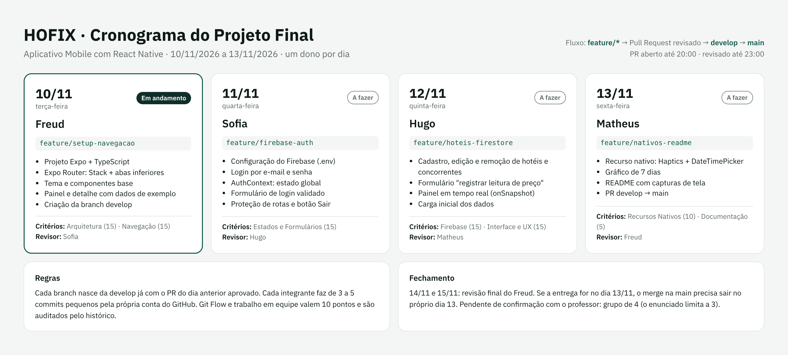

# Cronograma do Projeto Final

| Dia | Dono | Branch | Entrega | Revisor do PR |
|---|---|---|---|---|
| 10/11/2026 | Freud | `feature/setup-navegacao` | Projeto Expo + TypeScript, Stack + abas, tema, componentes base, painel e detalhe com dados de exemplo | Sofia |
| 11/11/2026 | Sofia | `feature/firebase-auth` | Firebase, login, `AuthContext`, formulário validado, proteção de rotas | Hugo |
| 12/11/2026 | Hugo | `feature/hoteis-firestore` | CRUD de hotéis e concorrentes, registro de leitura de preço, painel em tempo real | Matheus |
| 13/11/2026 | Matheus | `feature/nativos-readme` | Haptics + DateTimePicker, gráfico de 7 dias, README final, PR `develop` → `main` | Freud |

## Regras

- Fluxo: `feature/*` → Pull Request revisado → `develop` → `main`.
- Cada branch nasce da `develop` já com o PR do dia anterior aprovado.
- De 3 a 5 commits pequenos por pessoa, cada um pela própria conta do GitHub.
- PR aberto até 20:00 e revisado até 23:00.
